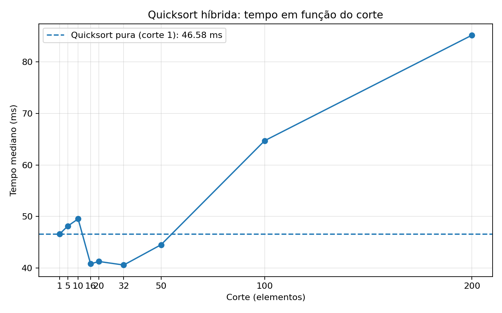

# Relatório — Quicksort híbrida com insertion sort

## Metodologia

- Tamanho do vetor: **20,000 elementos**.
- Valores gerados aleatoriamente com semente fixa: **20261022**.
- Repetições por configuração: **7**; foi usada a mediana dos tempos.
- Cada execução recebeu uma cópia do mesmo vetor; a cópia e a geração dos dados ficaram fora da medição.
- A quicksort usa pivô aleatório e partição em três grupos: menores, iguais e maiores que o pivô.
- Quando o trecho tem menos de `corte` elementos, é aplicado insertion sort.
- O caso `corte = 1` não aciona insertion sort para trechos de tamanho 1 ou maior e serve como baseline da quicksort pura.

## Resultados

| Corte | Tempo mediano (ms) | Diferença vs. quicksort pura |
|---:|---:|---:|
| 1 | 46.578 | +0.00% |
| 5 | 48.146 | +3.37% |
| 10 | 49.544 | +6.37% |
| 16 | 40.811 | -12.38% |
| 20 | 41.274 | -11.39% |
| 32 | 40.585 | -12.87% |
| 50 | 44.522 | -4.41% |
| 100 | 64.721 | +38.95% |
| 200 | 85.197 | +82.91% |

## Análise

- **Melhor corte observado:** `32`, com tempo mediano de **40.585 ms**.
- **Ganho em relação à quicksort pura:** 12.87% (medianas: 46.578 ms contra 40.585 ms).
- **Cortes grandes demais:** o insertion sort tem custo quadrático no tamanho do trecho. Quando o corte fica alto, ele pode ordenar trechos relativamente grandes por inserção, aumentando o trabalho e piorando o tempo. O ponto ideal depende dos dados, da implementação e da máquina.
- **Corte = 1:** comporta-se como a quicksort pura nesta implementação, pois não chama insertion sort para subvetores de tamanho positivo. Diferenças pequenas de tempo podem ocorrer por ruído de medição.

## Observações

Os tempos são específicos da máquina e da execução. Reexecute o experimento para verificar se a tendência se mantém.
